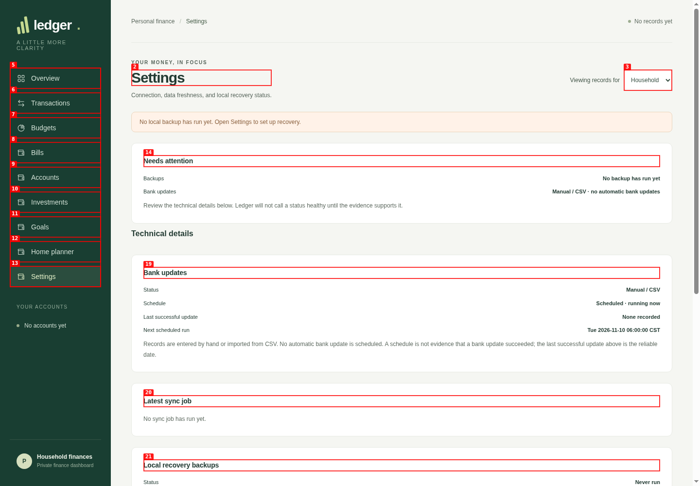
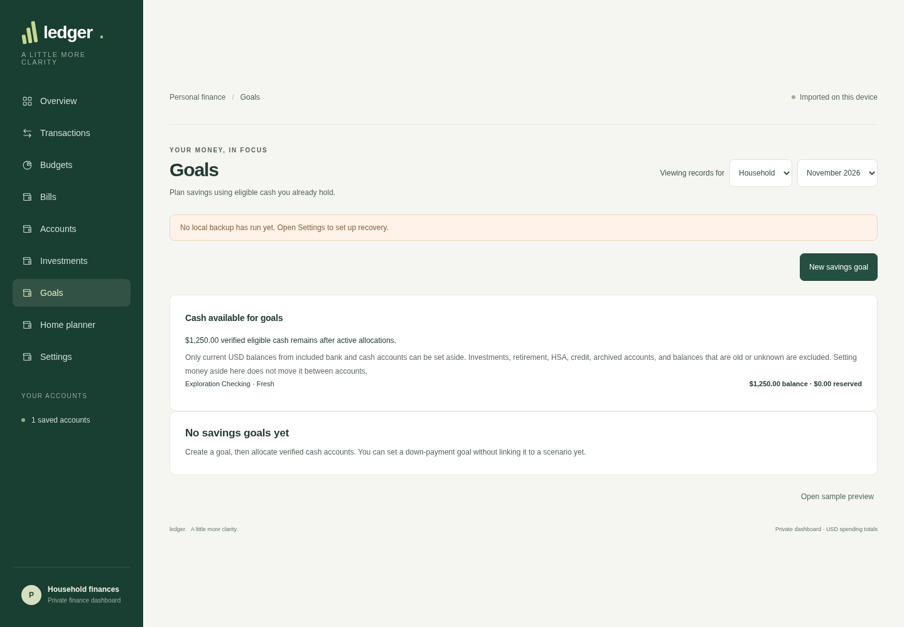
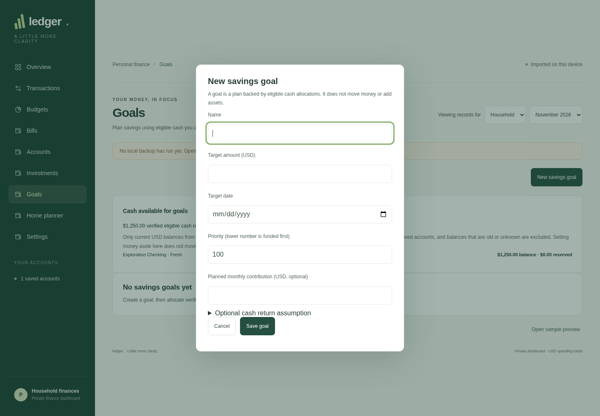
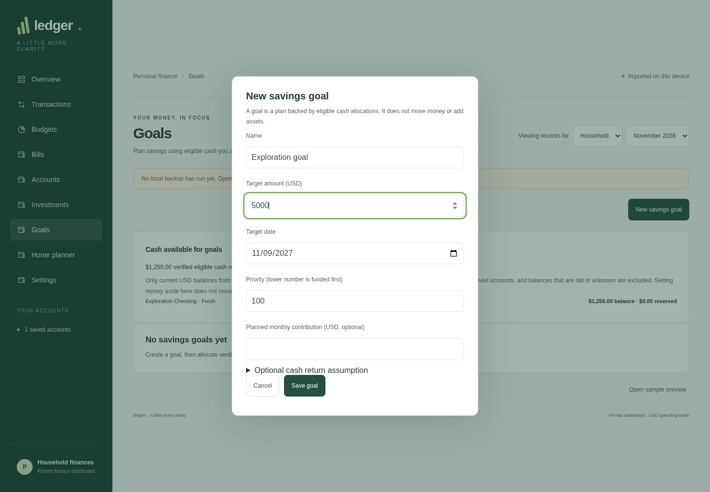
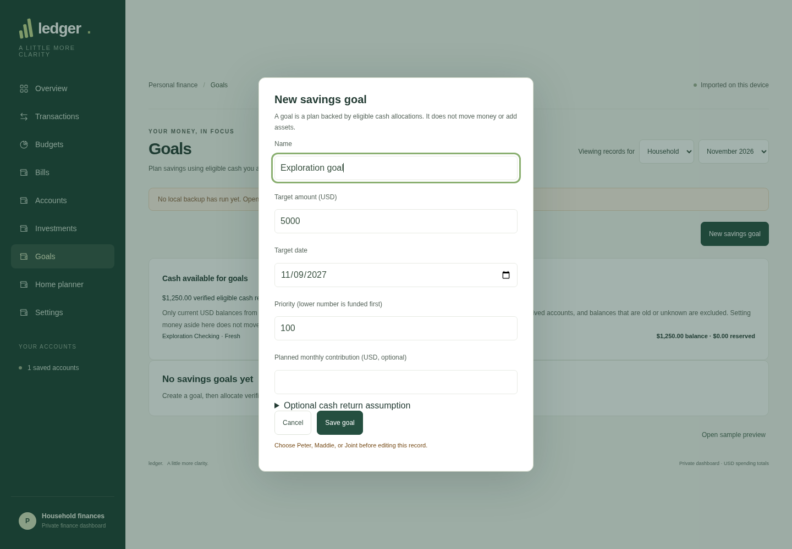
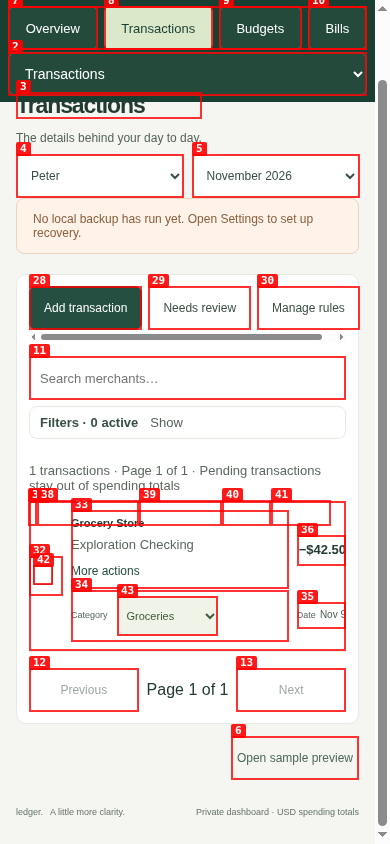
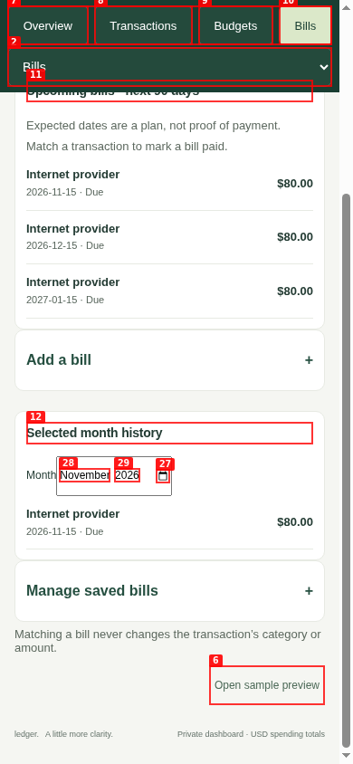

# Dogfood Report: Ledger

| Field | Value |
|-------|-------|
| **Date** | 2026-11-09 |
| **App URL** | http://127.0.0.1:4317 (isolated synthetic local-only instance) |
| **Session** | ledger-dogfood |
| **Scope** | Exploratory pass across all top-level Ledger areas, empty and populated states, data-entry flows, desktop and phone viewport |

## Summary

| Severity | Count |
|----------|-------|
| Critical | 0 |
| High | 0 |
| Medium | 2 |
| Low | 2 |
| **Total** | **4** |

## Issues

### ISSUE-001: Bank update status contradicts local-only configuration

| Field | Value |
|-------|-------|
| **Severity** | medium |
| **Category** | ux / content |
| **URL** | http://127.0.0.1:4317/?page=settings |
| **Repro Video** | N/A (static state) |

**Description**

In local-only mode with no provider configured, Settings reports the schedule as “Scheduled · running now” and shows a next scheduled run. The same panel says “Manual / CSV · no automatic bank updates” and explains “No automatic bank update is scheduled.” The simultaneous claims make it unclear whether Ledger is about to perform a bank update or whether a connection needs attention.

**Repro Steps**

1. Open the isolated local-only Ledger instance and choose Settings.
   
2. **Observe:** Bank updates shows “Manual / CSV” but its schedule says “Scheduled · running now,” while the explanatory copy says no automatic update is scheduled.
   

**Recommendation:** In local-only mode, show the schedule as “Not configured” or “No automatic updates,” and omit the next-run timestamp. Only show “running now” for an actual configured provider update job.

---

### ISSUE-002: Goal creation is offered in Household view but rejected without an owner

| Field | Value |
|-------|-------|
| **Severity** | medium |
| **Category** | ux / functional |
| **URL** | http://127.0.0.1:4317/?page=goals (Household profile) |
| **Repro Video** | Unavailable: agent-browser recording could not finalize because `ffmpeg` is not installed. Screenshots document the flow. |

**Description**

The Household Goals page exposes “New savings goal.” The form has no owner/profile field, and submitting a valid goal returns “Choose Peter, Maddie, or Joint before editing this record.” The user must abandon the form, change the global profile selector, and re-enter the goal; the UI gives no indication of this prerequisite before the user completes the form.

**Repro Steps**

1. From Goals, leave “Viewing records for” set to Household and open “New savings goal.”
   
2. Enter a name and target amount.
   
3. Enter a valid future target date and submit.
   
4. **Observe:** The goal is not created; the form displays “Choose Peter, Maddie, or Joint before editing this record.” There is no owner control in the form.
   

**Recommendation:** Either collect the goal owner in the form, or disable/explain goal creation in Household view before opening the form and offer a direct profile switch that preserves the draft.

---

### ISSUE-003: Mobile transaction row context labels are tiny

| Field | Value |
|-------|-------|
| **Severity** | low |
| **Category** | visual / accessibility |
| **URL** | http://127.0.0.1:4317/?page=transactions at 390px viewport |
| **Repro Video** | N/A (static layout) |

**Description**

On a phone-width transaction list, the contextual “Category” and “Date” labels render at 9px, substantially smaller than the values they explain. This makes row scanning harder, especially for users with low vision or when the display is viewed at a distance. The browser audit detector independently flagged both labels as undersized functional text.

**Repro Steps**

1. Open Transactions at 390px width and scroll to a transaction row.
   
2. **Observe:** “Category” and “Date” are rendered as tiny labels beside the category and date values.
   

**Recommendation:** Increase the mobile row labels to at least 11–12px while maintaining separation from the transaction values.

---

### ISSUE-004: Sticky mobile navigation overlaps scrolled page content

| Field | Value |
|-------|-------|
| **Severity** | low |
| **Category** | visual / responsive layout |
| **URL** | http://127.0.0.1:4317/?page=bills at 390px viewport |
| **Repro Video** | N/A (static layout) |

**Description**

On phone-width layouts, the sticky page selector and mobile navigation occupy the same vertical area as the scrolling content. After scrolling, the Bills section heading is visibly drawn behind the selector/navigation, making the heading partly obscured. The same overlap is visible on Transactions. This reduces readability and can make page context unclear.

**Repro Steps**

1. Set the viewport to 390px wide and open Bills.
2. Scroll down the page.
3. **Observe:** “Upcoming bills · next 90 days” scrolls underneath the sticky top controls and is partly hidden.
   

**Recommendation:** Reserve the combined sticky-header height above scrolling page content, or adjust the header/content positioning so content cannot pass underneath opaque controls.

---

## Fix verification

All four findings were fixed and verified on 2026-11-09:

- Local-only bank updates now show “Not applicable · manual / CSV” and “No automatic update scheduled,” regardless of stale timer metadata. The separate backup schedule remains visible.
- Goal forms now require an owner and default to the selected person/shared profile when available. Household view requires an explicit choice in the form.
- Mobile transaction context labels are 12px.
- The mobile sticky sidebar now paints an opaque, higher-stacking buffer at its lower edge so scrolled page content cannot bleed through.

Regression coverage: `scripts/check-finance.mjs` and `scripts/check-browser.mjs`. Verification passed: `npm run build`, `npm run check:source`, the finance checks, and browser acceptance at 1440px, 768px, 390px, 320px, and the 200%-zoom-equivalent viewport. The visual detector still reports the existing Inter font choice as a generic style advisory; that is outside these fixes.
